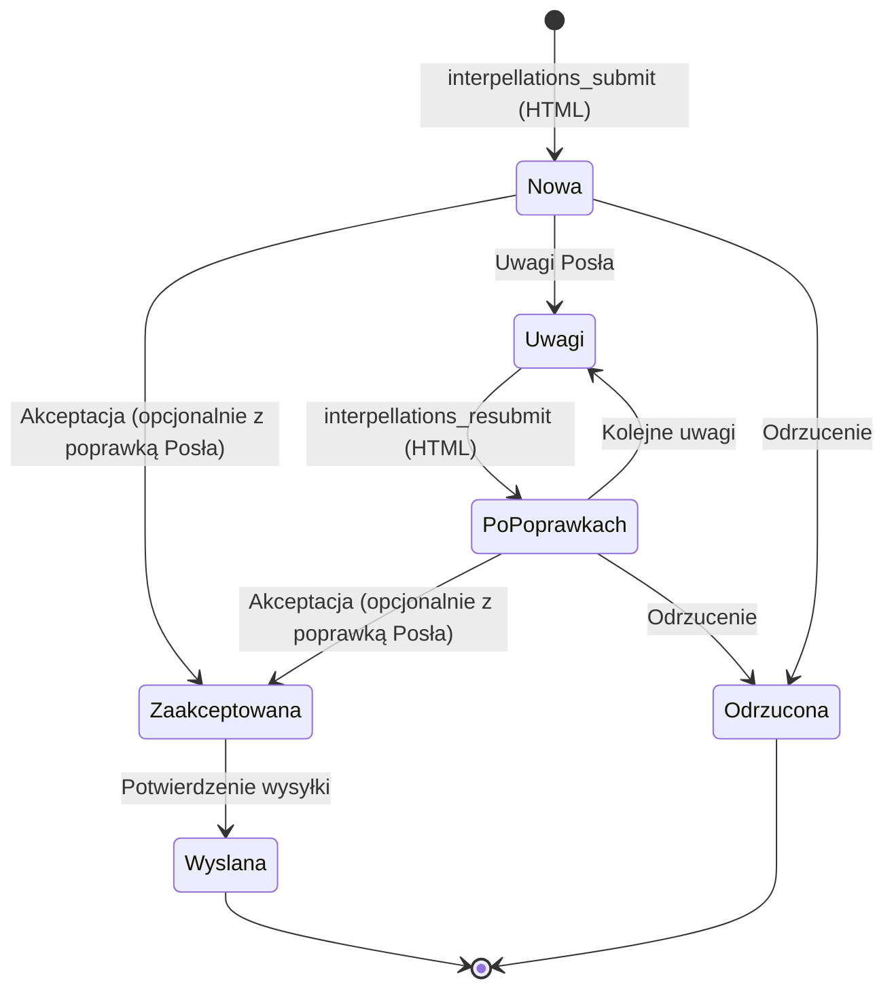

# Feature: Interpelacje

> Obieg akceptacji interpelacji: Pracownik przygotowuje dokument w Claude i wgrywa HTML przez MCP, Poseł podejmuje decyzję, a zaakceptowany dokument czeka maksymalnie 24 godziny na wysłanie.

## Role

- **Poseł / Administrator** — widzi wszystkie interpelacje, podejmuje decyzje, potwierdza wysłanie i może trwale usunąć rekord.
- **Pracownik** — tworzy interpelację i wgrywa poprawki przez MCP, odczytuje rekordy w swoim zakresie danych oraz potwierdza wysłanie.
- **Asystent** — odczyt w aplikacji zgodnie z `scope_interpellations`; nie ma dostępu do MCP.

Token MCP i aplikację OAuth może utworzyć Poseł, Administrator albo Pracownik po uwierzytelnieniu 2FA (`aal2`).

## Obieg

Statusy w bazie:

- `nowa` — nowy dokument czeka na decyzję Posła.
- `uwagi` — Pracownik otrzymał uwagi i ma przygotować poprawki.
- `po_poprawkach` — nowa wersja czeka na ponowną decyzję Posła.
- `zaakceptowana` — zaakceptowana, czeka na wysłanie; `deadline_at = accepted_at + 1 day`.
- `wyslana` — proces zakończony wysyłką.
- `odrzucona` — proces zakończony; rekord znajduje się w archiwum.

Trigger `interpellations_enforce_workflow()` egzekwuje przejścia, role, numer wersji i znaczniki czasu. Treść (`content_html`, `content_text`, `subject`, `recipient`) zmienia wyłącznie MCP (service role, bez `auth.uid()`) w dwóch przejściach: `uwagi` → `po_poprawkach` (Pracownik, `interpellations_resubmit`) oraz `nowa`/`po_poprawkach` → `zaakceptowana` (Poseł/Administrator poprawia sam przy akceptacji, migracja `20261110300000_interpellation_mp_correction.sql`); oba podnoszą `revision`. Dziennik audytu zapisuje każdą zmianę statusu. Odrzucenie nie przenosi danych do osobnej tabeli.

## Dane

Tabela `public.interpellations` przechowuje:

- `recipient` — odbiorca interpelacji (organ, np. „Minister Zdrowia”); w UI zawsze „Odbiorca”,
- `content_html` — HTML przekazany przez MCP po sanityzacji (`api/_lib/sanitize-html.ts`: allow-lista znaczników strukturalnych bez `style`/`class`/`id`/`hidden`, bez `<style>`/`<script>`/`<template>`/`<noscript>`/`<svg>`, linki tylko http(s)/mailto, obrazy tylko `data:image/*`; nieznane znaczniki rozpakowane) - create, resubmit i decide,
- `content_text` — tekst wyekstrahowany (html-to-text) z HTML po sanityzacji, więc podgląd i tekst kopiowany do Sejmu pokazują to samo; wiersze sprzed zmiany nie są przeliczane,
- `review_notes` — ostatnie uwagi lub komentarz Posła,
- `revision` — numer wersji, zwiększany przy `interpellations_resubmit` i przy poprawce Posła w `interpellations_decide`,
- `submitted_at`, `decided_at`, `accepted_at`, `deadline_at`, `sent_at`, `archived_at`,
- `decided_by`, `created_by`, `signatory_id`, opcjonalne `case_id`.

Podgląd HTML działa w `iframe sandbox=""`. Wbudowany CSP blokuje skrypty, formularze i zasoby sieciowe. Zakładka „Tekst” pokazuje `content_text` i pozwala skopiować go do schowka.

Tabela `public.interpellation_duration_samples` zachowuje ukończone pomiary:

- `submission_to_sent` — od pierwszego utworzenia do wysłania,
- `acceptance_to_sent` — od ostatniej akceptacji do wysłania,
- `feedback_to_revision` — od ostatnich uwag do wgrania poprawionej wersji.

Próbki powstają w tym samym triggerze i transakcji co zmiana etapu. Widok modułu pokazuje średnią bieżącego tygodnia kalendarzowego oraz procentową zmianę względem poprzedniego tygodnia. Dodatkowy kafel pokazuje liczbę interpelacji utworzonych od poniedziałku i udział wysłanych spośród nich.

## MCP

| Narzędzie | Role | Cel |
|---|---|---|
| `interpellations_list` | Poseł, Administrator, Pracownik | Lista etapów, wersji i terminów; filtry statusu, aktywnych i przeterminowanych |
| `interpellations_get` | Poseł, Administrator, Pracownik | Pełny rekord z HTML, tekstem i uwagami |
| `interpellations_submit` | Pracownik | Nowy HTML → ekstrakcja tekstu → `nowa` |
| `interpellations_resubmit` | Pracownik | Poprawiony HTML w statusie `uwagi` → `po_poprawkach`, `revision + 1` |
| `interpellations_decide` | Poseł, Administrator | `zaakceptowana`, `uwagi` albo `odrzucona`; przy `zaakceptowana` opcjonalnie `html`/`subject`/`recipient` — Poseł sam poprawia treść, zapis nowej wersji (`revision + 1`) i akceptacja w jednym kroku (audyt `mcp.interpellation_decide` z `corrected: true`) |
| `interpellations_mark_sent` | Poseł, Administrator, Pracownik | `zaakceptowana` → `wyslana` |
| `interpellations_delete` | Poseł, Administrator | Trwałe usunięcie |

MCP działa przez service role, dlatego każde zapytanie do tabeli stosuje `applyDataScope`. Uprawnienia narzędzi egzekwuje pole `roles` niezależnie od informacyjnej kolumny `mcp_tokens.scopes`.

## UI

- `/biuro/interpelacje` — trzy widoki (wybór zapamiętany w `localStorage`), wspólny filtr odbiorcy (porównanie bez wielkości liter i spacji na brzegach, `recipients.ts`):
  - **Lista** — „W toku” wg pilności, filtry statusów, archiwum, terminy; opcjonalne grupowanie wg odbiorcy. Pojedyncze etapy w toku też wg pilności (zaakceptowane wg terminu wysłania), wysłane/archiwum/„Wszystkie” od najnowszych. Nad filtrami pasek „Wymaga działania” zależny od roli, liczony dla całego biura: Poseł/Administrator „Czeka na Twoją decyzję” (`nowa` + `po_poprawkach`, filtr `decision`), osoby z zapisem „Do wysłania” z liczbą po terminie, Pracownik „Do poprawy”; ponowne kliknięcie wraca do „W toku”.
  - **Tablica** — kolumna na status obiegu, karty wg pilności, bez przeciągania (przejścia tylko przez dialogi decyzji/wysyłki).
  - **Kalendarz** — siatka miesiąca z terminami wysłania (`deadline_at` zaakceptowanych, kolor wg stanu terminu) i datami wysyłki (`sent_at`), lista wybranego dnia pod siatką.
- Wąski obszar modułu (telefon albo otwarty PoliAI): zawsze lista; bez opisu obiegu w nagłówku; filtr odbiorcy, grupowanie i licznik w jednym wierszu na pełną szerokość (poniżej `@sm` grupowanie jako sama ikona); wiersz listy ma etap i termin u góry obok akcji (44 px na telefonie), a temat na pełnej szerokości.
- Tablica: kolumny mają wysokość swojej zawartości (pusta kolumna kończy się pod "Brak interpelacji").
- Kafle wskaźników: 4 w wierszu od `@[56rem]`, 2 w wąskim module; każdy z dużą liczbą/czasem (bez danych wyszarzone "Brak danych", bez powtórzonego licznika 0 pomiarów).
- `/biuro/interpelacje/:id` — podgląd HTML/tekstu, historia, uwagi, decyzje i potwierdzenie wysyłki. Podgląd HTML ma margines dokumentu jak zakładka „Tekst” (własne style HTML go nadpisują). W jednej kolumnie (`@max-lg`) panel „Działania” stoi nad treścią, a zakładka „Tekst” ma naturalną wysokość; na wąskim obszarze (`@max-md`) nagłówek nie ma ikony. „Usuń interpelację” jest pod historią. Przy `po_poprawkach` notatka Posła ma tytuł „Uwagi do poprzedniej wersji”.
- `/biuro` — KPI obiegu, alerty decyzji/poprawek/przeterminowanych wysyłek i lista najpilniejszych interpelacji.
- Nad listą widoczne są trzy średnie czasy procesu, trendy tydzień-do-tygodnia oraz liczba dokumentów utworzonych i wysłanych w bieżącym tygodniu.
- `/biuro/admin/integracje/mcp` — tokeny MCP i aplikacje OAuth.

Stary edytor, generowanie szkicu przez `ai-proxy`, eksport PDF i statusy `draft/generated/edited/sent` zostały usunięte.

## Kluczowe pliki

- `supabase/migrations/20261023110000_interpellation_review_workflow.sql`
- `supabase/migrations/20261023170000_interpellation_metrics_guard_realtime.sql` — próbki czasu, blokada zmiany sprawy/sygnatariusza przez Pracownika, realtime
- `api/_lib/tools/interpellations.ts`
- `src/hooks/useInterpellations.ts`
- `src/hooks/useInterpellationMetrics.ts`
- `src/lib/interpellations.ts`
- `src/pages/Interpelacje.tsx`
- `src/pages/InterpellationDetail.tsx`
- `src/components/interpellations/*`
- `src/components/dashboard/InterpellationsCard.tsx`
- `src/hooks/useDashboardStats.ts`
