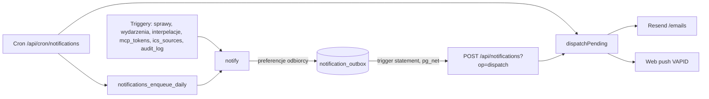

# Powiadomienia (e-mail Resend + web push PWA)

Integracja globalna instancji. Poseł/Administrator konfiguruje ją w Integracje → Powiadomienia
(`/biuro/admin/integracje/powiadomienia`); każdy użytkownik wybiera rodzaje i kanały w
Mój profil → Powiadomienia (`/biuro/profil#powiadomienia`). Migracje
`20261109100000_notifications.sql` (włącza `pg_net`) i
`20261109200000_notifications_fixes.sql` (włącza `pg_cron`: ponowienia co 2 min).
Powiadomienia w portalu (dzwonek w TopBarze): `20261111400000_notifications_inbox.sql` (po
`20261111100000` / `20261111300000`) - sekcja „Dzwonek” niżej.

Gdy wysyłka e-mail nie jest skonfigurowana w biurze (`status` → `email.available = false`), w Mój profil
→ Powiadomienia wiersz „E-mail”, kolumna e-mail i wszystkie jej przełączniki są wyszarzone i wyłączone
(pokazane jako wyłączone, zapisane preferencje zostają na później) z pomarańczową informacją: dla
pracownika/asystenta „Aby otrzymywać powiadomienia e-mail, poproś administratora o ich konfigurację.”,
dla Posła/administratora link do Integracje → Powiadomienia (`NotificationSettingsSection.tsx`).

## Przepływ

- `notify(user, kind, payload, dedupe_key)` wstawia wiersz tylko, gdy odbiorca chce choć jeden
  kanał (`notification_wants`: preferencje albo domyślne z `notification_catalog()`; push tylko
  przy zarejestrowanym urządzeniu). `dedupe_key` + UNIQUE (user, kind, dedupe) = bez duplikatów
  (podsumowanie tygodnia `week:IYYY-IW`, termin sprawy `due:<id>:<data>` itd.).
- Błąd w triggerze powiadomień nigdy nie przerywa operacji biznesowej (`exception when others →
  raise warning`).
- `notify()` = `notify_in_app()` (skrzynka `notification_inbox`, w osobnym bloku `exception`:
  błąd skrzynki nigdy nie zabiera e-maila/push) + `notify_outbox()` (kolejka, dawna treść
  `notify()` bez zmian). Zwraca `true`, gdy wstawiono cokolwiek. `notify_public_submission`
  wstawia do skrzynki sam (jeden wiersz na okno 15 min, `count` +1, wiersz wraca na górę jako
  nieprzeczytany), a do kolejki przez `notify_outbox` (okna kolejki bez zmian).
- Wysyłka natychmiastowa: trigger `notification_outbox_kick` (AFTER INSERT FOR EACH STATEMENT)
  woła `notifications_dispatch_request()` → `net.http_post` na adres i token z
  `notification_server_config`. Adres rejestruje serwer (`syncDispatchRegistration` w
  `settings.ts`: przy `admin_status`, `admin_save` i w porannym cronie) wyłącznie z konfiguracji
  operatora: `NOTIFICATIONS_DISPATCH_URL`, inaczej `${configuredInstanceOrigin()}/api/notifications?op=dispatch`
  (`OAUTH_ISSUER`, inaczej `VERCEL_PROJECT_PRODUCTION_URL`); nigdy z `app_settings` ani nagłówków
  żądania. Bez adresu z konfiguracji istniejąca rejestracja zostaje (lokalnie: kolejkę opróżnia
  cron). Nowy adres = nowy token. W bazie (migracja `20261110100000_notifications_hardening.sql`)
  CHECK `notification_server_config_dispatch_url_safe` (tylko `https://<host>` bez portu albo
  `http://host.docker.internal:<port>`, stała ścieżka `/api/notifications?op=dispatch`) i trigger
  `notification_server_config_guard` (zmiana adresu bez nowego tokenu → token losowany w bazie,
  brak adresu → brak tokenu). Token porównywany w stałym czasie (SHA-256 + `timingSafeEqual`).
- Ponowienia: pg_cron `notifications-rekick` co 2 min woła `notifications_rekick()`, które
  zgłasza wysyłkę, gdy w kolejce jest wiersz do wysłania teraz (odłożone ponowienie, wygasła
  blokada, nieudane zgłoszenie pg_net). Bez pg_net / pg_cron kolejkę opróżnia codzienny cron.
  Zadanie `cron-run-details-cleanup` czyści historię pg_cron starszą niż 3 dni.
- `dispatchPending` (`api/_lib/notifications/dispatch.ts`): paczki po 20 przez
  `notifications_claim` (skip locked, blokada 3 min), e-mail z `Idempotency-Key:
  notification-<id>`, odstęp 550 ms (limit Resend), ponowienia e-maila (1, 5, 30, 120, 720 min,
  maks. 5 prób; 429 nie liczy się jako próba), push wysyłany raz (`push_status` zapisywany od
  razu po wysyłce). Koniec czasu albo błąd przed wysyłką → wiersze wracają do kolejki.
- Aktor zdarzenia: `auth.uid()`, a dla operacji przez MCP / PoliAI (service_role) kolumna
  rekordu - `created_by` przy nowej sprawie / wydarzeniu / interpelacji, `decided_by` przy
  decyzji. Aktor nie dostaje powiadomienia o własnym działaniu. Wyjątek: zmiana `assigned_to`
  istniejącej sprawy przez MCP nie ma kolumny aktora, więc przypisanie sprawy samemu sobie przez
  PoliAI wysyła powiadomienie.

## Rodzaje (`notification_catalog()` = `src/lib/notifications.ts`)

| kind | Źródło | Odbiorca |
|---|---|---|
| `security_integration` | INSERT `mcp_tokens` (ręczny token albo OAuth), INSERT `ics_sources` | właściciel |
| `security_account` | audyt `user.sessions_revoked`, `mfa.admin_reset`, `user.profile_update` (rola / `scope_*`, gdy zmienia ktoś inny) | konto, którego dotyczy |
| `case_assigned` | `cases.assigned_to` (INSERT/UPDATE, nie aktor, sprawa otwarta) | przypisany |
| `case_deadline` | cron: `due_date` = jutro, sprawa otwarta | przypisany, inaczej autor |
| `case_mention` | INSERT `case_comments` z `mentions` (trigger `case_comments_after_insert`, `20261111300000`) | wspomniany (nie autor); domyślnie e-mail, push i portal |
| `case_comment` | ten sam trigger | przypisany i autor sprawy (nie autor komentarza, nie wspomniany); domyślnie tylko portal |
| `public_submission` | INSERT `cases` z `source='public_form'` | aktywni z `scope_cases='all'` (domyślnie włączone tylko Poseł/administrator); grupowane przez `notify_public_submission` w okna 15 min na odbiorcę (klucz `public:<nr okna>`): pierwsze od razu, czekające = licznik `count` +1, po wysłaniu kolejne zbiorczo w następnym oknie (`next_attempt_at` = początek okna, wysyła rekick) - zalew = 1 powiadomienie / 15 min |
| `event_assigned` | `events.assigned_to` | przypisany |
| `interpellation_review` | status `nowa` / `po_poprawkach` | sygnatariusz z rolą Poseł/administrator, inaczej wszyscy z tą rolą (tylko te role) |
| `interpellation_decision` | status `uwagi` / `zaakceptowana` / `odrzucona` | autor i sygnatariusz (bez aktora) |
| `responsibility` | audyt `module_owners.update` (nowe osoby) | osoba |
| `signing_request` | RPC `signing_create_documents` / `signing_replace_original` (dokumenty do podpisu, jedno na wywołanie z `count`/`titles`) | aktywni Poseł/administrator poza aktorem (tylko te role) |
| `signing_decision` | RPC `signing_return` / `signing_attach_signed` / `signing_mark_sent` | autor dokumentu (bez aktora) |
| `weekly_digest` | cron w dniu `weekly_digest_day` (domyślnie poniedziałek) | każdy z preferencją |
| `daily_digest` | cron codziennie (poza dniem podsumowania tygodnia) | każdy z preferencją (domyślnie wyłączone) |

Podsumowania (`notification_digest(user, 'day'|'week', dzień)`): przeterminowane i bliskie terminy
spraw osoby (przypisane albo utworzone i nieprzypisane), wydarzenia osoby, interpelacje z uwagami
i po terminie wysłania; Poseł/administrator dodatkowo liczby biura (przeterminowane, bez osoby,
nowe zgłoszenia, interpelacje do decyzji); budżet miesiąca (Poseł/administrator i opiekun
Budżetu, tylko tydzień). Puste podsumowanie = brak wysyłki.

`user.sessions_revoked` i `user.access_revoked` usuwają też urządzenia push konta.

## Tabele i RPC

- `notification_preferences` (PK `user_id`): `email_enabled`, `push_enabled`, `kinds` jsonb
  (`{kind: {email?, push?}}`), `weekly_digest_day` 1-7. Brak grantów dla klienta; RPC
  `get_my_notification_preferences()` (wartości efektywne dla rodzajów roli) i
  `set_my_notification_preferences(email, push, day, kinds)` (NULL = bez zmian, allow-lista rodzajów).
  Kanał `in_app` per rodzaj w tym samym `kinds` (`{kind: {email?, push?, in_app?}}`), bez
  przełącznika głównego; domyślnie włączony (poza `admin_default_only` dla ról spoza
  Posła/administratora). Podsumowania i `test` nie mają kanału `in_app` (RPC nie zwraca klucza,
  zapis odrzuca `22023`).
- `notification_inbox` (`20261111400000`): `user_id`, `kind`, `payload` (migawka z chwili
  zdarzenia), `dedupe_key` (UNIQUE z user/kind), `created_at`, `read_at`. RLS: SELECT własnych
  wierszy przy `is_authenticated_active() and is_aal2()`; `authenticated` ma tylko SELECT (wymóg
  Realtime), zapis wyłącznie RPC. W publikacji `supabase_realtime`. Limit 100 wierszy/h na
  odbiorcę (bez limitu: `security_account`, `security_integration`, `case_deadline`). Retencja 90
  dni (pg_cron `notification-inbox-retention`, 03:45). Trigger
  `profiles_purge_inbox_on_access_change`: zmiana roli, `scope_*` albo dezaktywacja usuwa
  skrzynkę użytkownika poza `security_*`. RPC (każda rola, aal2, inaczej `42501`):
  `get_my_inbox(p_limit=30, p_before, p_before_id)` (najnowsze najpierw, kursor `(created_at, id)`),
  `get_my_inbox_unread_count()`, `mark_my_inbox_read(p_ids uuid[], p_until timestamptz)` (`p_ids`
  = wskazane; NULL = wszystkie nieprzeczytane, z `p_until` tylko utworzone do tej chwili).
- `notification_catalog()` redefiniowany w `20261111400000` w bloku `DO` z asercją: migracja
  przerywa się, gdy nowa lista gubi albo zmienia rodzaj z poprzedniej definicji. Nowe rodzaje
  wyłącznie w migracji o wersji wyższej niż `20261111400000`, z pełną listą (dziś 16). Po
  wdrożeniu: `select count(*) from public.notification_catalog()` = 16.
- `push_subscriptions`: endpoint UNIQUE z CHECK na usługi push (FCM, Mozilla, Apple, Windows -
  ochrona SSRF, ponownie sprawdzane w `push.ts`), klucze, `user_agent`, `failure_count`. SELECT
  własnych wierszy (kolumny bez kluczy); zapis RPC `register_my_push_subscription` (upsert po
  endpoint - urządzenie przechodzi na bieżące konto, maks. 20 na konto) i
  `remove_my_push_subscription` (bez aal2 - wylogowanie z wygasłą sesją).
- `notification_outbox`: kolejka i historia (retencja 90 dni). Klient widzi tylko przez
  `get_notification_deliveries(limit)` (Poseł/administrator + aal2, bez treści). `notify()` wstawia
  najwyżej 30 wierszy na godzinę na odbiorcę dla rodzajów wyzwalanych działaniem innych osób
  (bez limitu: `security_*`, `case_deadline`, `weekly_digest`, `daily_digest`, `test`);
  indeks `notification_outbox_user_created_idx`.
- `notification_server_config` (jeden wiersz, tylko service_role): `dispatch_url`,
  `dispatch_token`, publiczny klucz VAPID (para generowana przy pierwszym użyciu; zmiana = ponowna
  subskrypcja). Prywatny klucz VAPID w Supabase Vault (`notifications:vapid_private_key`, zapis
  `service_store_vapid_keys`, odczyt `service_get_secrets`; migracja `20261110170000_secrets_vault.sql`).
- Sekret `resend_api_key` jak klucze AI/GetResponse: zaszyfrowany w Vault, zapis `set_secret_setting`,
  status `get_secret_settings_status`, odczyt serwera `service_get_secrets`, redakcja w audycie i MCP
  `settings_list`.
- `app_settings.notifications_settings`: `email_enabled`, `push_enabled`, `from_email`,
  `from_name`, `reply_to`, `app_url`, `include_titles`. Zapis przez `op=admin_save` (walidacja),
  klientem z sesją użytkownika - RLS Posła + audyt `setting.update` z aktorem. Odczyt
  (`parseSettings`) stosuje te same reguły, więc zły adres wpisany wprost do `app_settings` jest
  traktowany jak pusty. `app_url` (baza linków w e-mailach): gdy adres instancji jest
  skonfigurowany, zawsze on (`loadSettings` ignoruje wartość z bazy, `admin_save` odrzuca inny
  host); wartość administratora działa tylko bez konfiguracji (lokalnie, domyślnie adres z żądania).

## Dzwonek (powiadomienia w portalu)

- UI: `src/components/notifications/inbox/` - `NotificationBell` (w `TopBar` między trybem
  prywatnym a menu konta; plakietka `1`…`9`, `9+`; `aria-label` „Powiadomienia, nieprzeczytane:
  N”; region `role="status"` tylko przy wzroście licznika), `NotificationPanel` (`DialogPrimitive`:
  desktop panel pod dzwonkiem z przezroczystą nakładką, telefon arkusz od dołu `max-h-[85dvh]`;
  grupy Dzisiaj / Wczoraj / Wcześniej, „Pokaż starsze” po 30, stany ładowania / pusty / błąd),
  `NotificationListItem` (cały wiersz = `Link`). Brak RPC w bazie (`PGRST202`) = dzwonek się nie
  renderuje (bez flagi funkcji).
- Dane: `src/hooks/useNotificationInbox.ts` (`INBOX_KEY`, `useInboxUnreadCount` - staleTime
  30 s, odświeżanie przy fokusie i co 5 min; `useInboxList`; `useMarkInboxRead` - optymistycznie;
  `useInboxRealtime` - kanał `inbox-<uid>`, INSERT/UPDATE z filtrem `user_id`, zdarzenie =
  unieważnienie `INBOX_KEY` po 300 ms, ponowne `SUBSCRIBED` = odświeżenie). DELETE nie jest
  subskrybowany (Realtime nie stosuje RLS do DELETE i niesie samo `id`).
- Treść: `renderInboxItem(kind, payload)` w `src/lib/notificationInbox.ts` (tytuł, opis, `href`
  ze stałych tras + `encodeURIComponent`, ikona, `record`). Tytuły spraw i fragmenty komentarzy
  zawsze (`include_titles` dotyczy tylko e-maili). Nieznany rodzaj = treść ogólna, link `/biuro`.
  Linki: sprawy `/biuro/sprawy?open=<id>`, wydarzenia `/biuro/kalendarz?open=<id>`, interpelacje
  `/biuro/interpelacje/<id>`, dokumenty `/biuro/dokumenty/<id>` (zbiorcze: lista), zgłoszenia
  zbiorcze `/biuro/sprawy`, `security_account` `/biuro/profil`, `security_integration` i
  `responsibility` jak CTA e-maila.
- Odczyt: kliknięcie pozycji, „Oznacz wszystkie jako przeczytane” (`p_until` = `created_at`
  najnowszej wczytanej pozycji), auto-odczyt po wejściu na adres rekordu (`inboxHrefMatches`:
  ścieżka + parametr `open`; push, e-mail, wyszukiwarka). Otwarcie panelu niczego nie oznacza.
- Tryb prywatny: `AppShell` nie renderuje TopBara przy blokadzie, więc dzwonek, panel i kanał
  znikają. Bez toastów z treścią powiadomień i bez licznika w tytule karty.
- Realtime po świeżym logowaniu z TOTP wymaga `supabase.realtime.setAuth(token)` przy
  `MFA_CHALLENGE_VERIFIED` (`AuthContext`; supabase-js przekazuje token tylko przy
  `SIGNED_IN`/`TOKEN_REFRESHED`). Test: `/tmp/eposel-hist/rt-inbox-check.mjs`.
- Nowy rodzaj powiadomienia = 5 miejsc: `notification_catalog()` (nowa migracja, pełna lista),
  `NOTIFICATION_KINDS` (`src/lib/notifications.ts`), `buildMessage` (`api/_lib/notifications/templates.ts`),
  `renderInboxItem` (`src/lib/notificationInbox.ts`), tabela „Rodzaje” wyżej.

## API (`api/notifications.ts`)

| op | Metoda | Kto |
|---|---|---|
| `status` | GET | każda rola: dostępność e-mail/push, publiczny klucz VAPID |
| `test` | POST `{channel}` | każda rola, do siebie, 1/min/kanał (wiersz `kind='test'` od razu `sending`) |
| `admin_status` | GET | Poseł/administrator: ustawienia, klucz (końcówka), `GET /domains` Resend, stan wysyłki |
| `admin_save` | POST | Poseł/administrator |
| `dispatch` | POST | token z `notification_server_config` (pg_net) |

E-mail dostępny, gdy: `INSTANCE_EMAIL=on` (env operatora, ADR 028 - przy `off` `resend.ts` odmawia każdego
zapytania, kolejka oznacza e-mail `skipped`, `op=test` z kanałem e-mail zwraca 409 `email_wylaczony`, panel
pokazuje „Wysyłka e-mail jest wyłączona przez operatora instancji”, zapisane `email_enabled` zostaje, ale jest
pomijane; push działa bez zmian), `email_enabled`, klucz, `from_email` i adres portalu (adres instancji,
inaczej `app_url`). Treść: `api/_lib/notifications/templates.ts` (bloki → HTML z inline CSS + tekst).
Tytuły spraw/wydarzeń/interpelacji i uwagi do interpelacji tylko przy `include_titles`. Push nigdy
nie zawiera tytułów (ekran blokady): tytuł rodzaju, krótki opis, link. `public_submission`: temat
zawsze stały (tytuł pisze anonim, a e-mail idzie z adresu biura); w treści tylko przy `include_titles`,
z etykietą „Tytuł podany przez zgłaszającego”, do 80 znaków, z rozbrojonymi `://` i `www.`.

Cron: `/api/cron/notifications` (`0 5 * * *` UTC = 6:00-7:59 w Polsce) w jednej funkcji
`api/cron/[job].ts` razem z `sync-ics` i `poliai-purge` (limit 12 funkcji Vercel Hobby).

## PWA / push

- `public/push-sw.js` dołączony do service workera przez `workbox.importScripts` (vite.config.ts):
  `push` → `showNotification` (ikona `/apple-touch-icon.png`, `tag` = rodzaj + link, więc
  powiadomienia o różnych sprawach się nie zastępują), `notificationclick` → fokus okna portalu i
  nawigacja albo nowe okno (tylko ta sama domena).
- Klient: `src/lib/pushSubscription.ts` (`subscribePush` z gestu użytkownika, odnowienie przy
  zmianie klucza VAPID, `usePushSubscriptionSync` w `AppShell` - raz na sesję rejestruje
  subskrypcję tylko po zmianie endpointu albo konta (znacznik `app.push.registered` w
  localStorage; urządzenie usunięte z listy na innym urządzeniu nie wraca samo), wylogowanie
  odpina urządzenie: `removeThisDevicePush` przed `signOut`, maks. 1,5 s). „Włączone” w UI =
  subskrypcja w przeglądarce i wiersz na serwerze.
- iOS: push tylko w zainstalowanej aplikacji (iOS 16.4+); stan `needs-install` w UI.
  `pnpm dev` nie ma service workera (`no-service-worker`).
- Pulpit: `PushPromptBanner` w zainstalowanej PWA, gdy push dostępny i zgoda nieudzielona.
- Integracje → Powiadomienia: karta „Historia wysyłek” (`NotificationDeliveriesCard`) pokazuje
  10 najnowszych wysyłek; „Pokaż wszystkie” rozwija listę do 50 (bez kilku ekranów historii).

## Smoke test lokalnie

Własny `supabase start` w `/tmp/<katalog>` (pg_net jest w obrazie), atrapa Resend
(`RESEND_API_URL=http://127.0.0.1:<port>`), `NOTIFICATIONS_DISPATCH_URL=http://host.docker.internal:<port vite>/api/notifications?op=dispatch`
(baza w Dockerze woła serwer deweloperski na hoście), `pnpm exec vite` z nadpisanymi
`VITE_SUPABASE_*`/`SUPABASE_*`. Push bez sieci: podmiana `webpush.sendNotification` na
`webpush.generateRequestDetails` (prawdziwy VAPID + aes128gcm) w skrypcie node.
